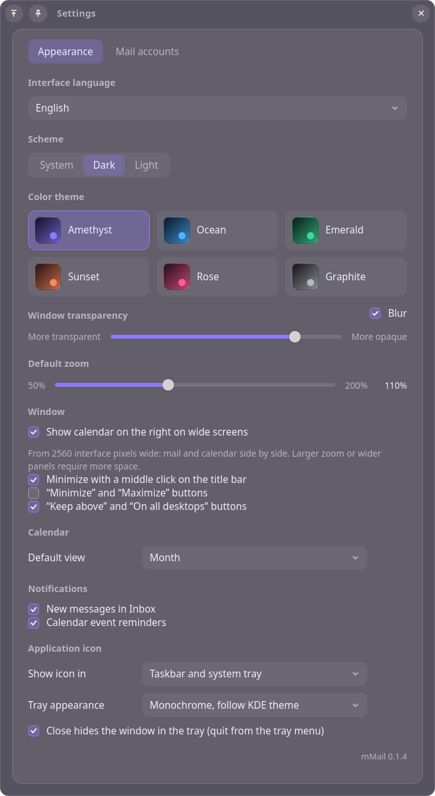
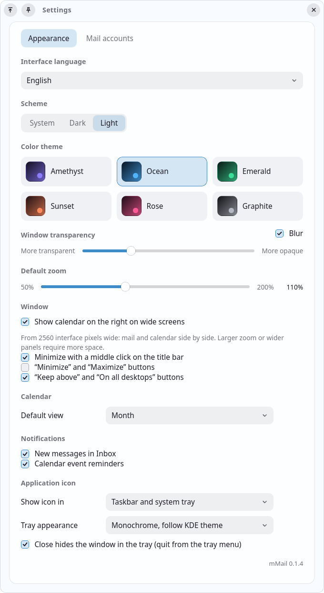

# mMail

Почтовый клиент с календарём для KDE Plasma (Wayland): стеклянный интерфейс с настоящим
размытием KWin, ящики Яндекса и Gmail, Google Календарь. Ядро на Rust, интерфейс на Svelte,
оболочка — Tauri 2.

<p align="center">
  
  
</p>

## Возможности

- **Почта:** несколько ящиков Яндекса и Gmail (IMAP), все папки сервера, «Все ящики», «Важные»,
  поиск, отметки прочитанного и важного, корзина, «Отметить все прочитанными».
- **Письма:** отдельное окно с форматированием, HTML-кодом или простым текстом; ответ и пересылка
  с цитатой; вложения до 25 МБ; отправка по SMTP.
- **Календарь:** Google Календарь — месяц, неделя или день; создание и правка событий,
  напоминания. Рядом с почтой на широком экране.
- **KDE:** размытие KWin, тема «как в системе», уведомления Plasma с кнопками
  («Ответить», «Прочитано», «Удалить», «Отложить»), значок в трее со счётчиком непрочитанных.
- **Перевод** письма или выделенного текста (Google Translate, только по команде).
- **Интерфейс** на русском, английском и сербском; шесть цветовых гамм, светлая и тёмная схема.
- **Командная строка** в стиле Thunderbird — чтобы другие программы могли подготовить письмо
  (см. ниже).

## Безопасность и приватность

- Пароли приложений, ключ кэша и ключи Google хранятся только в KWallet (Secret Service).
- Кэш писем на диске зашифрован целиком (SQLCipher, AES-256), файлы доступны только владельцу.
- HTML письма очищается (ammonia) и показывается в песочнице без скриптов со строгой CSP.
- Внешние картинки — только по кнопке (или для доверенных отправителей с пройденной проверкой
  DMARC). Скачивает их ядро: без cookies и Referer, без доступа к локальной сети.
- Ссылки открываются в браузере только после подтверждения; обманные ссылки
  (текст говорит об одном домене, ведут на другой) и домены с омоглифами помечаются.
- Окна письма и настроек не имеют доступа к чтению почты.
- IMAP и SMTP — только TLS с проверкой сертификата. Google — OAuth с PKCE.

Подробнее о данных — в [PRIVACY.md](PRIVACY.md).

## Установка

Готовый пакет собирается в `dist-deb/`:

```sh
scripts/build-deb.sh
sudo apt install ./dist-deb/mMail_<версия>_amd64.deb
```

При переустановке той же версии добавьте `--reinstall`.

### Подключение ящиков

В настройках mMail → «Почтовые ящики» укажите адрес и **пароль приложения** (не основной пароль):

- Яндекс: Яндекс ID → Безопасность → Пароли приложений → «Почта»;
  в настройках почты должен быть включён доступ по IMAP.
- Gmail: аккаунт Google → Безопасность → Пароли приложений (нужна двухэтапная аутентификация).

### Google Календарь

Нужен свой OAuth-клиент: Google Cloud Console → APIs & Services → включить Google Calendar API →
Clients → Create client → **Desktop app**. Client ID и Client secret вводятся в настройках mMail,
вход идёт в браузере.

## Командная строка

`mmail` открывает окно нового письма с заполненными полями. Отправляет письмо всегда человек.

```sh
mmail -compose "to='a@b.c,d@e.f',subject='Тема',body='Текст',attachment='/путь/файл.pdf'"
mmail -compose "to='a@b.c',subject='Отчёт',message='/путь/текст.txt'"   # текст из файла
mmail compose --to a@b.c --subject 'Тема' --attach файл.pdf < текст.txt
mmail mailto:a@b.c?subject=Тема
```

Параметры `-compose`: `to`, `cc`, `bcc`, `subject`, `from` (один из ящиков), `body` или
`message` (файл UTF-8), `attachment` (через запятую). Относительные пути считаются от текущей
папки. Ссылки `mailto:` не могут прикладывать файлы.

## Разработка

Нужны Rust (stable), Node.js 20+ и пакеты:

```sh
sudo apt install libwebkit2gtk-4.1-dev libayatana-appindicator3-dev librsvg2-dev libssl-dev build-essential
npm install
npm run app        # dev-режим с перезагрузкой интерфейса
```

`npm run app` запускается через `scripts/clean-env.sh`: VS Code из snap передаёт дочерним
процессам свои пути GTK, и без очистки WebKitGTK падает.

Тесты:

```sh
npm test                       # интерфейс
cd src-tauri && cargo test     # ядро
```

Ярлык и значок для меню KDE в dev-режиме — `scripts/install-desktop.sh`.

### Устройство

| Каталог | Что внутри |
| --- | --- |
| `src/` | интерфейс (Svelte 5): главное окно, окно письма, настройки |
| `src/lib/translations.json` | переводы — общие для интерфейса и ядра |
| `src-tauri/src/imap.rs`, `smtp.rs` | синхронизация и отправка почты |
| `src-tauri/src/store.rs`, `db.rs` | письма в памяти и шифрованный кэш |
| `src-tauri/src/sanitize.rs`, `remote.rs`, `links.rs` | очистка HTML, внешние картинки, ссылки |
| `src-tauri/src/google.rs`, `calendar.rs` | OAuth и Google Календарь |
| `src-tauri/src/blur.rs`, `tray.rs`, `notify.rs` | размытие KWin, трей, уведомления |
| `src-tauri/capabilities/` | права каждого окна на команды ядра |

## Лицензия

[MIT](LICENSE)
